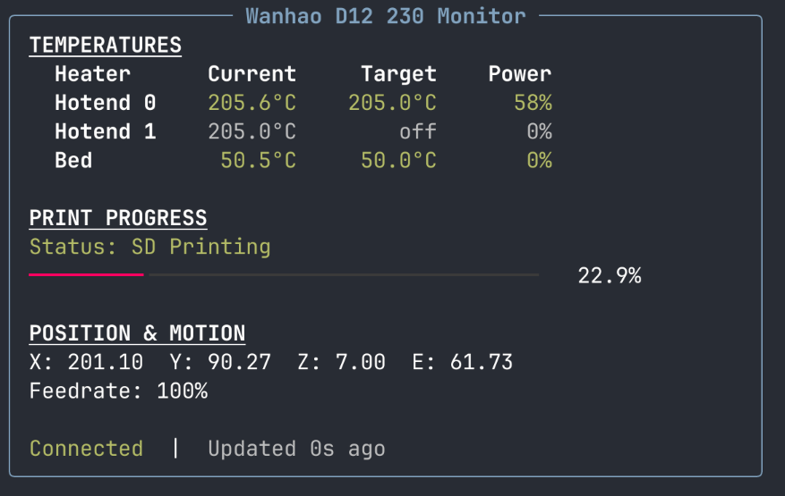

# wanhao-d12-230-cli-monitor

A lightweight, terminal-based live dashboard for the **Wanhao D12 230** 3D printer over USB serial.

> **Note:** This project has been mostly vibecoded with the help of AI assistants.

If you just want to keep an eye on temperatures, print progress, and position without running a full OctoPrint server, this tool gives you a clean Rich-powered terminal UI that refreshes in real time.



## Features

- **Dual hotend + heated bed temperatures** with current/target/power display
- **SD card print progress** with a progress bar
- **Position tracking** (X/Y/Z/E) and feedrate percentage
- **Color-coded status** — green when at target, yellow when heating, dim when off
- **REST API** with OpenAPI docs via `serve` subcommand
- **Auto-reconnect** — survives any serial error, and finds the printer again if it comes back under a new `/dev/ttyUSB*` name
- **Verbose logging** mode for debugging serial communication
- **Graceful shutdown** on Ctrl+C or SIGTERM

## Requirements

- **Python 3.10+**
- **Linux** (tested on Ubuntu/Debian — uses `/dev/ttyUSB*` serial devices)
- **Wanhao D12 230** connected via USB cable

## Installation

```bash
git clone https://github.com/wixyvir/wanhao-d12-230-cli-monitor.git
cd wanhao-d12-230-cli-monitor
poetry install
```

## Finding Your Serial Device

When the printer is connected via USB, it typically appears as `/dev/ttyUSB0`. To find the correct device:

```bash
# List USB serial devices
ls /dev/ttyUSB*

# Check kernel messages for recently connected devices
dmesg | grep tty

# Stable names that survive unplug/replug
ls -l /dev/serial/by-id/
```

:factory: `/dev/ttyUSB*` numbers can change when the USB link drops and comes back (e.g. `ttyUSB0` becomes `ttyUSB1`). The most stable choice is the `/dev/serial/by-id/` link, e.g. `--port /dev/serial/by-id/usb-1a86_USB_Serial-if00-port0`.

When the configured port disappears, the monitor reconnects to the device by its remembered `/dev/serial/by-id/` link, or, failing that, to the only `/dev/ttyUSB*` device present. It never guesses when several are plugged in.

If you get a **permission denied** error, add your user to the `dialout` group:

```bash
sudo usermod -aG dialout $USER
# Log out and back in for the change to take effect
```

## Quick Start

```bash
# Default: connect to /dev/ttyUSB0 at 115200 baud
poetry run wanhao-d12-230-cli-monitor

# Specify a different serial port
poetry run wanhao-d12-230-cli-monitor --port /dev/ttyUSB1

# Custom baud rate and polling interval
poetry run wanhao-d12-230-cli-monitor --baud 250000 --interval 5.0

# Enable verbose logging (writes to printer_monitor.log)
poetry run wanhao-d12-230-cli-monitor -v
```

## REST API Server

:factory: The `serve` subcommand starts a REST API with OpenAPI documentation:

```bash
# Start the API server on default port 8000
poetry run wanhao-d12-230-cli-monitor serve

# Custom host, HTTP port, and serial port
poetry run wanhao-d12-230-cli-monitor serve --host 127.0.0.1 --http-port 9000 --port /dev/ttyUSB1

# OpenAPI docs available at http://localhost:8000/docs
```

The server stays up even if the printer is disconnected and automatically retries the connection. The `/status` endpoint returns the full printer state as JSON:

```bash
curl http://localhost:8000/status
```

:factory: `connected` is `false` while the port is unavailable (`last_error` holds the serial error) and also when the port is open but the firmware answers nothing for a full poll cycle (`last_error` is `"No response from printer"`). In the second case the port is not reopened, because reopening toggles DTR, which can reset the board mid-print. `last_update` is the time of the last successful poll, so its age tells you how stale the data is.

### Serve Options

| Option | Default | Description |
|--------|---------|-------------|
| `--port` | `/dev/ttyUSB0` | Serial port to connect to |
| `--host` | `0.0.0.0` | Bind address |
| `--http-port` | `8000` | HTTP port |
| `--baud` | `115200` | Baud rate for serial communication |
| `--interval` | `2.5` | Polling interval in seconds |
| `-v`, `--verbose` | off | Log all serial TX/RX to `printer_monitor.log` |

### Running as a systemd Service

:factory: To keep the server running across reboots and USB drops, run it as a systemd system unit. Point `ExecStart` at the virtualenv's executable (from `poetry env info -p`) rather than `poetry run`, and use the stable `/dev/serial/by-id/...` path. Example `/etc/systemd/system/printer-monitor.service`:

```ini
[Unit]
Description=Wanhao D12 230 printer monitor (HTTP :8111)
After=network-online.target
Wants=network-online.target
StartLimitIntervalSec=300
StartLimitBurst=10

[Service]
Type=simple
User=youruser
WorkingDirectory=/home/youruser/monitor
ExecStart=/path/to/venv/bin/wanhao-d12-230-cli-monitor serve --http-port 8111 --port /dev/serial/by-id/usb-1a86_USB_Serial-if00-port0
Restart=always
RestartSec=10

[Install]
WantedBy=multi-user.target
```

Do **not** bind the service to the adapter's `.device` unit (`BindsTo=`/`WantedBy=dev-serial-by\x2did-….device`): the server already survives unplugs and reconnects through the by-id link on its own. When the printer is powered on, the CH340 adapter drops and comes back within ~250 ms; with a device binding, systemd stopped the service on the drop and never started it again. `Restart=always` covers real crashes. The user must be in the `dialout` group to open the port.

```bash
sudo systemctl daemon-reload
sudo systemctl enable --now printer-monitor.service
journalctl -u printer-monitor -f   # follow logs
```

### Home Assistant

:factory: A plan to expose the printer in Home Assistant through this REST API (ready-to-copy `rest:` package first, then a HACS custom integration) is in [docs/home-assistant-plan.md](docs/home-assistant-plan.md). Nothing is implemented yet.

## CLI Options

| Option | Default | Description |
|--------|---------|-------------|
| `--port` | `/dev/ttyUSB0` | Serial port to connect to |
| `--baud` | `115200` | Baud rate for serial communication |
| `--interval` | `2.5` | Polling interval in seconds |
| `-v`, `--verbose` | off | Log all serial TX/RX to `printer_monitor.log` |

## Architecture

```
printer_monitor/
├── state.py         # PrinterState + HeaterState dataclasses (shared between threads)
├── parsers.py       # Pure functions parsing M105/M27/M114/M220 G-code responses
├── serial_conn.py   # SerialConnection + PrinterPoller daemon thread
├── dashboard.py     # build_dashboard() → Rich Panel from PrinterState
├── cli.py           # Argparse entry point, signal handling, threading
├── server.py        # FastAPI REST API server (serve subcommand)
└── __main__.py      # python -m printer_monitor support
```

The poller thread sends G-code status queries (M105, M27, M114, M220) at the configured interval and updates a shared `PrinterState` dataclass. The main thread runs a Rich `Live` display that renders the dashboard at 2 Hz.

## Compatibility

This tool was built for the **Wanhao D12 230** (dual-extruder, Marlin firmware). It may work with other Marlin-based printers that respond to the same G-code commands (M105, M27, M114, M220), but this has not been tested.

## Known Limitations

- **SD card printing only** — print progress tracking relies on M27 (SD byte progress). Prints sent via USB host (e.g., from a slicer) are not tracked.
- **Linux only** — serial device paths assume `/dev/ttyUSB*`. May work on macOS with `/dev/tty.usbserial-*` but untested.
- **Read-only** — this is a monitoring tool only. It does not send print commands or modify printer settings.

## Contributing

See [CONTRIBUTING.md](CONTRIBUTING.md) for development setup, code style, and how to submit changes.

## License

This project is licensed under the [GNU General Public License v3.0 or later](LICENSE).
